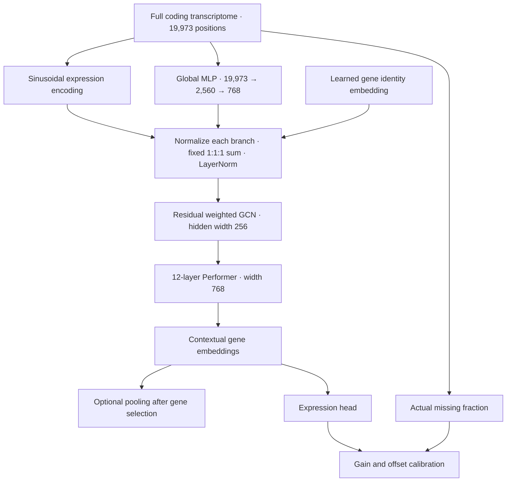

<h1 align="center">BulkFormer-Latest</h1>
<p align="center"><strong>Contextual gene representations from complete bulk transcriptomes</strong></p>
<p align="center">
<a href="https://github.com/KangBoming/BulkFormer">BulkFormer model family</a> ·
<a href="docs/models/latest.md">Model card</a> ·
<a href="https://drive.google.com/drive/folders/1wKXEgKk_oPkmaCITi4ASs-05FHl6qkvZ">Weights</a> ·
<a href="notebooks/bulkformer-latest_feature_extraction.ipynb">GPU notebook</a>
</p>

**BulkFormer-Latest** is a 154.55M-parameter model for human bulk RNA-seq. It encodes the full coding transcriptome to produce **768-dimensional contextual gene embeddings** and expression predictions. Use it for gene-level features, gene-set analyses and expression recovery. For sample-level representation learning, start with **[BulkFormer-Atlas](https://github.com/KangBoming/BulkFormer)**, the family's sample-oriented model.

## Release — 2026-11-04

This release publishes **epoch 19 / update 140,885**, the best completed checkpoint by mean ID/OOD validation MSE at 10% masking. Its immutable identity is `latest-20261104-epoch19-update140885`. The former 101.3M Latest release is archived under [v1plus-20261009](https://github.com/KangBoming/bulkformer-latest/tree/v1plus-20261009); its Google Drive weights remain unchanged. The current model uses a new architecture, vocabulary resources and package API. [Migration guide](docs/migration.md).

## Model architecture



| Component | Configuration |
|---|---|
| Parameters | **154,551,299** |
| Coding-gene vocabulary | **19,973** human Ensembl IDs |
| Hidden width / layers / heads | **768 / 12 / 12** |
| Attention | Performer, 256 random features per head |
| Feed-forward / GCN hidden width | 3,072 / 256 |
| Global transcriptome MLP | 19,973 → 2,560 → 768 |
| Input fusion | Separately normalized gene ID, expression and global context; fixed **1:1:1** |
| Dropout | Feed-forward / GCN: 0.1; attention: 0.05 |
| Missingness calibration | 64-hidden-unit network; bounded expression gain and offset |
| Expression scale | **Natural ln(TPM + 1)** |
| GenePT / CLS token | Neither is used |

The fixed fusion coefficients do not freeze the encoder, global MLP, GCN residual scale or calibrator. [Architecture comparison with Atlas](docs/architecture.md).

## Pretraining configuration

| Setting | Value |
|---|---|
| Data sources | ARCHS4, DiSignAtlas, GDC and GTEx |
| Split | **711,826 train / 3,746 ID validation / 3,602 OOD validation** |
| Objective | Dynamically masked expression MSE |
| Added masking | Uniform **10–20% per sample**, centered at 15% |
| Optimizer | AdamW, β=(0.9, 0.95), weight decay 0.01, gradient clipping 1.0 |
| Learning rate | First **1%** of updates: linear warmup to **1e-4**; then constant |
| Batch / precision | One GPU × 4 samples × 24 accumulation steps = **96**; BF16 |
| Budget / released checkpoint | 20 epochs planned / **epoch 19** |
| Selection | Minimum mean ID/OOD MSE at 10% masking |

Epoch-19 validation: **ID MSE 0.1477805855**, **OOD MSE 0.2003244350**, mean **0.1740525102**. [All validation mask rates](benchmarks/latest_pretraining.csv) · [Training JSON](configs/latest_training.json).

## Input coverage matters

Provide the **most complete available coding transcriptome**. Full gene coverage preserves context used by the model; substantial missingness can reduce performance. Training additionally masked 10–20% of source-available genes. This range is not a guarantee of accuracy at arbitrary total missingness, which also includes genes unavailable in the source data.

**To form a sample vector from HVGs or DEGs, still pass the full transcriptome.** First obtain contextual gene embeddings, then select those genes and pool their vectors. Selecting returned outputs does not shrink the encoder input.

Keep measured zeros as zeros. Omit unavailable genes or use `NaN`; the preparation function aligns the complete vocabulary and inserts the missing-value sentinel. Use human Ensembl gene IDs and declare the input scale explicitly. [Normalization and coverage guide](docs/input-guide.md).

## Quick start

```bash
git clone https://github.com/KangBoming/bulkformer-latest.git
cd bulkformer-latest
conda env create -f configs/inference.yaml
conda activate bulkformer
pip install -e . --no-deps
jupyter lab
```

```python
import pandas as pd
from bulkformer import download_model, load_latest, prepare_latest_input, extract_latest

model_dir = download_model("latest", "model/latest")
model, vocab = load_latest(model_dir, device="cuda")
counts = pd.read_csv("examples/demo_counts.csv", index_col=0)
expression, coverage = prepare_latest_input(counts, vocab, input_scale="counts")

genes = vocab.index[vocab["symbol"].isin(["TP53", "EGFR", "BRCA1"])].to_numpy()
features = extract_latest(model, expression, gene_indices=genes,
                          return_expression=True, batch_size=1)
gene_embeddings = features["gene_embeddings"]
sample_embeddings = features["sample_embeddings"]
```

The [notebook](notebooks/bulkformer-latest_feature_extraction.ipynb) includes actual GPU outputs: input coverage, selected genes, embedding previews, subset pooling and masked expression recovery. Its eight synthetic profiles demonstrate usage, not biological performance. Use `precision="fp32"` when full-precision inference is needed; sparse GPU reductions can still produce small numerical variation. [Validation record](model/validation/gpu.json).

The [Google Drive folder](https://drive.google.com/drive/folders/1wKXEgKk_oPkmaCITi4ASs-05FHl6qkvZ) contains **one complete FP32 `model.pt`**, model/training configuration, gene vocabulary, graph files, environment and checksums. [Download details](model/README.md).

## PRIMO and model selection

[PRIMO](https://github.com/PRIMOmics/primo-eval) evaluates omics foundation-model representations on patient-level drug-development tasks. Models provide sample embeddings, which are scored using the same downstream predictor; most labels remain private. Its bulk RNA-seq board covers **five task families**: clinical score prediction, molecular endotype classification, perturbation response prediction, prognosis, and treatment outcome prediction.

As of **2026-11-04**, the official bulk board reports **59 tasks, 39 cohorts and 4,922 patients**, with **19 leaderboard entries**. Our full feature submissions cover **44 datasets / 6,390 samples**; the screenshot reports the official scored view.

[](https://primomics-primo-eval.hf.space/?tab=leaderboard)

*Direct screenshot of the official page; original names and all ranked entries are preserved. Click to open the live board. [Full-resolution image](docs/assets/primo-official-bulk-leaderboard-20261104.png) · [Capture record](docs/assets/primo-official-bulk-leaderboard-20261104.json).*

The external aliases are `BulkFormer-variant` for Atlas and `BulkFormer-V3Plus` for Latest. Latest's submission uses this same epoch-19 checkpoint; the older rows named `BulkFormer-Latest` belong to the archived release. `+ HVG` denotes concatenation with the organizer's 1,200-gene expression baseline. Rankings can change; the first-place result applies to Atlas **with** HVG.

Atlas has the stronger PRIMO aggregate sample-level result. Latest's gene-level workflow recommendation follows its architecture and objective; a matched gene-level Atlas-versus-Latest benchmark is still needed before claiming superiority. [Full protocol and category results](benchmarks/primo/README.md) · [Live board](https://primomics-primo-eval.hf.space/?tab=leaderboard).

## Original models and citation

The original 37M–147M models, downloads and publication notebook are retained in the **[BulkFormer family repository](https://github.com/KangBoming/BulkFormer#original-model-family)**. They use separate configurations and resources.

Kang, B., Fan, R., Yi, M., Cui, C., & Cui, Q. **BulkFormer: A large-scale foundation model for bulk transcriptomes.** *Cell Systems*, 101657 (2026). [DOI](https://doi.org/10.1016/j.cels.2026.101657).

The current Atlas and Latest checkpoints are subsequent research releases, not the checkpoints evaluated in that paper. Report the immutable checkpoint ID and protocol in analyses. Code: [MIT](LICENSE). Contact: [Boming Kang](mailto:kangbm@bjmu.edu.cn) · [Qinghua Cui](mailto:cuiqinghua@bjmu.edu.cn).
