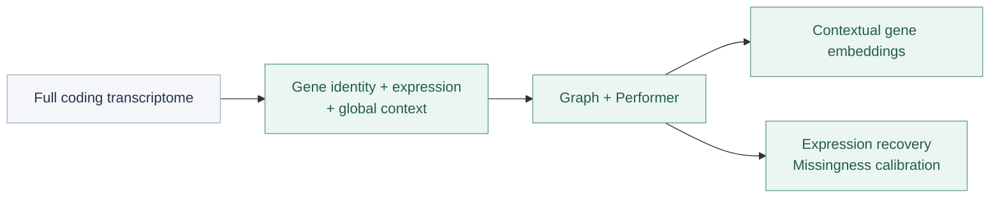
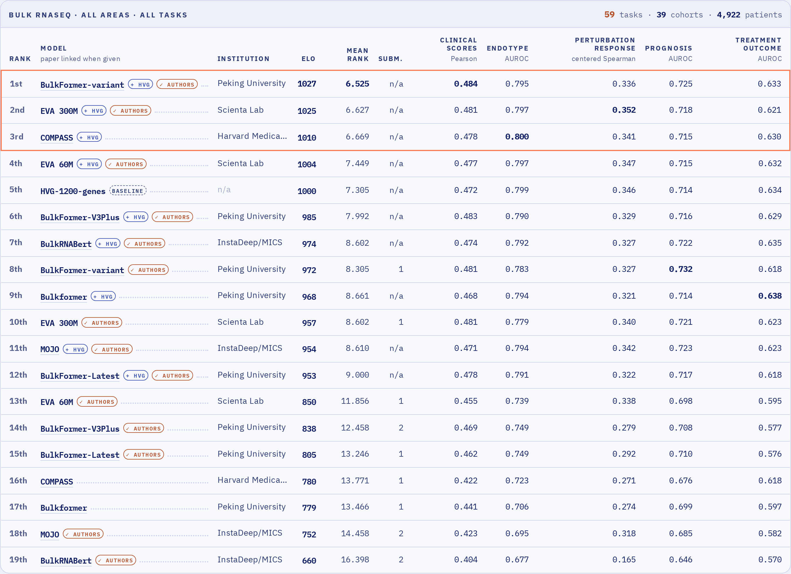

<h1 align="center">BulkFormer-Latest</h1>
<p align="center"><strong>Contextual gene representations from bulk transcriptomes</strong><br>Full transcriptome context · Gene features · Expression recovery</p>
<p align="center">
  <a href="docs/models/latest.md"></a>
  <a href="https://drive.google.com/drive/folders/1wKXEgKk_oPkmaCITi4ASs-05FHl6qkvZ"></a>
  <a href="LICENSE"></a>
</p>
<p align="center">
  <a href="https://github.com/KangBoming/BulkFormer">Model family</a> ·
  <a href="#model-architecture">Architecture</a> ·
  <a href="#quick-start">Quick start</a> ·
  <a href="notebooks/bulkformer-latest_feature_extraction.ipynb">Tutorial</a> ·
  <a href="#contact">Contact</a>
</p>

**BulkFormer-Latest** encodes the complete available human coding transcriptome to produce **768-dimensional contextual gene embeddings** and expression predictions. Use it for gene features, gene-set analyses and expression recovery. For sample-level prediction, start with **[BulkFormer-Atlas](https://github.com/KangBoming/BulkFormer)**.

> **2026-11-06 · Checkpoint update:** The download now provides the **final epoch-20 checkpoint**, with updated checksums and an executed GPU tutorial. The published PRIMO results remain those of epoch 19; epoch 20 has not been evaluated on PRIMO. [Download guide](model/README.md).

> **2026-11-04 · New release:** Complete weights, inference resources and an executed GPU tutorial are available. Users of the previous Latest release should follow the [migration guide](docs/migration.md).

## Model architecture



| Architecture | Configuration |
|---|---|
| Parameters / coding genes | **154.55M / 19,973** |
| Encoder width / layers / heads | **768 / 12 / 12** |
| Input fusion | Normalized gene identity, expression and global context; fixed **1:1:1** sum |
| Graph / global context | GCN hidden width **256**; MLP **19,973 → 2,560 → 768** |

[Model card](docs/models/latest.md) · [Architecture comparison with Atlas](docs/architecture.md) · [Model configuration](configs/latest_model.json)

## Input coverage matters

Provide the **most complete available coding transcriptome**. Missing genes remove context and can reduce performance. The expression head accounts for input missingness, while sufficient gene coverage remains important.

**To form a sample vector from HVGs or DEGs, still pass the full transcriptome.** First obtain contextual gene embeddings, then select those genes and pool their vectors. Selecting returned outputs does not shrink the encoder input.

Keep measured zeros as zeros. Omit unavailable genes or use `NaN`; the preparation function aligns the complete vocabulary and inserts the missing-value sentinel. Use human Ensembl gene IDs and declare the input scale explicitly. [Normalization and coverage guide](docs/input-guide.md).

## Quick start

```bash
git clone https://github.com/KangBoming/bulkformer-latest.git
cd bulkformer-latest
conda env create -f configs/inference.yaml
conda activate bulkformer
pip install -e . --no-deps
jupyter lab
```

```python
import pandas as pd
from bulkformer import download_model, load_latest, prepare_latest_input, extract_latest

model_dir = download_model("latest", "model/latest")
model, vocab = load_latest(model_dir, device="cuda")
counts = pd.read_csv("examples/demo_counts.csv", index_col=0)
expression, coverage = prepare_latest_input(counts, vocab, input_scale="counts")

genes = vocab.index[vocab["symbol"].isin(["TP53", "EGFR", "BRCA1"])].to_numpy()
features = extract_latest(model, expression, gene_indices=genes,
                          return_expression=True, batch_size=1)
gene_embeddings = features["gene_embeddings"]
sample_embeddings = features["sample_embeddings"]
```

The [notebook](notebooks/bulkformer-latest_feature_extraction.ipynb) includes actual GPU outputs: input coverage, selected genes, embedding previews, subset pooling and masked expression recovery. Its eight synthetic profiles demonstrate usage, not biological performance. Use `precision="fp32"` when full-precision inference is needed; sparse GPU reductions can still produce small numerical variation. [Validation record](model/validation/gpu.json).

The [Google Drive folder](https://drive.google.com/drive/folders/1wKXEgKk_oPkmaCITi4ASs-05FHl6qkvZ) contains **one complete FP32 `model.pt`**, architecture configuration, gene vocabulary, graph files, environment and checksums. [Download details](model/README.md).

## PRIMO and model selection

[PRIMO](https://github.com/PRIMOmics/primo-eval) is an open benchmark of omics foundation models for patient-level drug-development tasks. It evaluates sample embeddings with a common downstream prediction protocol across **five task families**: clinical scores, molecular endotypes, perturbation responses, prognosis and treatment outcomes.

The official bulk board contains **59 tasks · 39 cohorts · 4,922 patients**, with **19 ranked entries** as of **2026-11-04**. Our complete submissions cover **44 datasets and 6,390 samples**; these describe submission coverage, while the board reports the scored patient population.

**BulkFormer-Atlas + HVG ranks 1st in this snapshot.** The corresponding official submission name is `BulkFormer-variant + HVG`.

[](https://primomics-primo-eval.hf.space/?tab=leaderboard)

*Official screenshot, 2026-11-04. [Live leaderboard](https://primomics-primo-eval.hf.space/?tab=leaderboard) · [Full-resolution image](docs/assets/primo-official-bulk-leaderboard-20261104.png) · [Capture record](docs/assets/primo-official-bulk-leaderboard-20261104.json)*

<details>
<summary><strong>Submission names and evaluation protocol</strong></summary>

- **Atlas** appears as `BulkFormer-variant`; the **epoch-19 Latest** submission appears as `BulkFormer-V3Plus`. These scores do not evaluate the current final epoch-20 download. Older rows named `BulkFormer-Latest` refer to the archived release.
- **+ HVG** concatenates the embedding with the organizer's **1,200-gene expression baseline**. It is separate from Atlas's 4,096-gene input panel. Atlas alone ranks 8th in this snapshot.
- Rankings can change, and small Elo differences do not establish statistical significance. [Full results and protocol](benchmarks/primo/README.md) document preprocessing, public-task model selection and the limits of the pretraining-overlap audit.

</details>

Atlas has the stronger aggregate sample-level result. Latest's gene-level recommendation follows its architecture and outputs; a matched gene-level comparison remains to be established.

## Original models and citation

The original 37M–147M models, downloads and publication notebook are retained in the **[BulkFormer family repository](https://github.com/KangBoming/BulkFormer#original-model-family)**. They use separate configurations and resources.

Kang, B., Fan, R., Yi, M., Cui, C., & Cui, Q. **BulkFormer: A large-scale foundation model for bulk transcriptomes.** *Cell Systems*, 101657 (2026). [DOI](https://doi.org/10.1016/j.cels.2026.101657).

Atlas and the current Latest checkpoint are subsequent research releases. Please also report the model name, checkpoint ID and evaluation protocol. Code is available under the [MIT license](LICENSE).

## Contact

- **Boming Kang** — [kangbm@bjmu.edu.cn](mailto:kangbm@bjmu.edu.cn)
- **Qinghua Cui** — [cuiqinghua@bjmu.edu.cn](mailto:cuiqinghua@bjmu.edu.cn)
